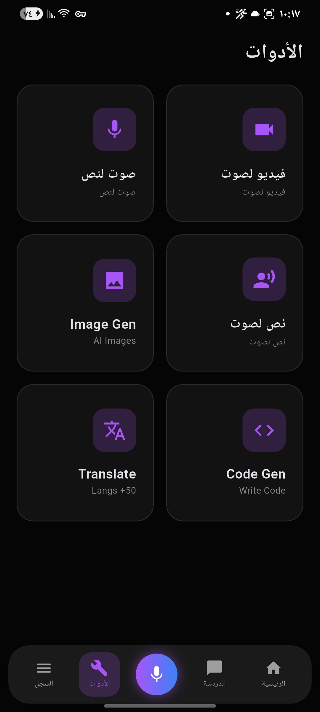
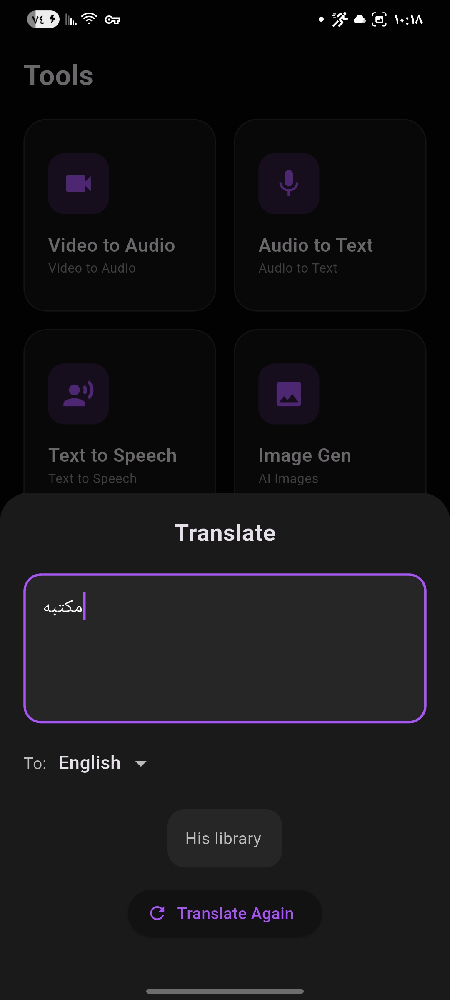
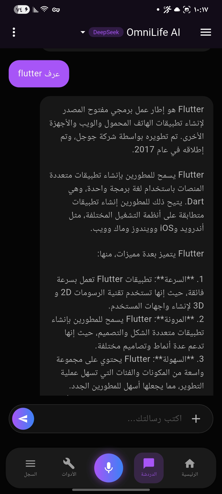
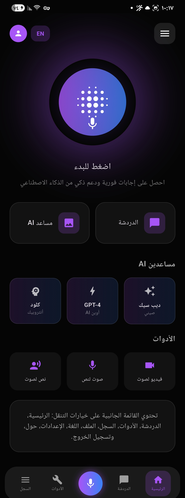

# OmniLife AI

**مساعد ذكي يجمع المحادثة والأدوات المدعومة بالذكاء الاصطناعي في تطبيق واحد.**

مشروع تطبيق جوّال بواجهة عصرية داكنة، صُمّم لتقديم تجربة سهلة للتفاعل مع المساعد الذكي والوصول إلى مجموعة من الأدوات من مكان واحد. يدعم التطبيق العربية والإنجليزية، مع ضبط اتجاه الواجهة تلقائيًا ليتوافق مع اللغة.

## لقطات من التطبيق

### الشاشة الرئيسية

### المحادثة مع المساعد الذكي

### أدوات الذكاء الاصطناعي

### مثال على أداة الترجمة

## أبرز المزايا

- محادثة مع مساعد ذكي مع اختيار النموذج.
- واجهة عربية وإنجليزية، مع دعم اتجاه الكتابة من اليمين إلى اليسار.
- أدوات لتصميم تجربة تشمل الترجمة، وتوليد الشيفرات، وتحويل الصوت إلى نص، والنص إلى كلام، وتحويل الفيديو إلى صوت، وتوليد الصور.
- تصميم داكن مع تنقّل بين الرئيسية والمحادثة والأدوات والسجل والملف الشخصي.
- اختيار الملفات الصوتية لاستخدامها مع ميزة تحويل الصوت إلى نص.

تختلف جاهزية الأدوات بحسب مزوّد الذكاء الاصطناعي والخدمات الخلفية المتاحة. في النسخة الحالية، تتصل المحادثة والترجمة وتوليد الشيفرات وتحويل الصوت إلى نص بواجهات API؛ أما بعض الأدوات الأخرى فتحتاج إلى مزوّد أو خدمة خلفية تدعمها.

## التقنيات المستخدمة

- **Flutter وDart** لبناء واجهة التطبيق ومنطقها.
- **Material Design** لبناء مكوّنات الواجهة والتصميم الداكن.
- **Groq API** للتفاعل مع نماذج المحادثة ومعالجة النصوص، مع دعم واجهات متوافقة مع OpenAI.
- **HTTP** لإرسال طلبات API واستقبال النتائج.
- **Llama 3.3** للمحادثة والترجمة وتوليد الشيفرات.
- **Whisper** لتحويل الصوت إلى نص.
- **File Picker** لاختيار الملفات من الجهاز.
- **AudioPlayers** لتشغيل الصوت.
- **Path Provider** للتعامل مع مسارات الملفات على الجهاز.
- **Flutter Localizations** ودعم مخصّص للعربية والإنجليزية.

## عن المشروع

**الاسم:** OmniLife AI  
**النوع:** تطبيق مساعد ذكي وأدوات إنتاجية  
**المنصة:** تطبيق مبني باستخدام Flutter  
**اللغات في الواجهة:** العربية والإنجليزية
